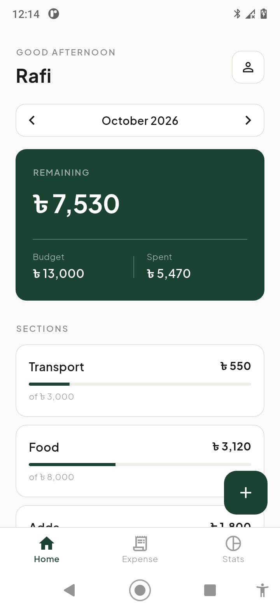
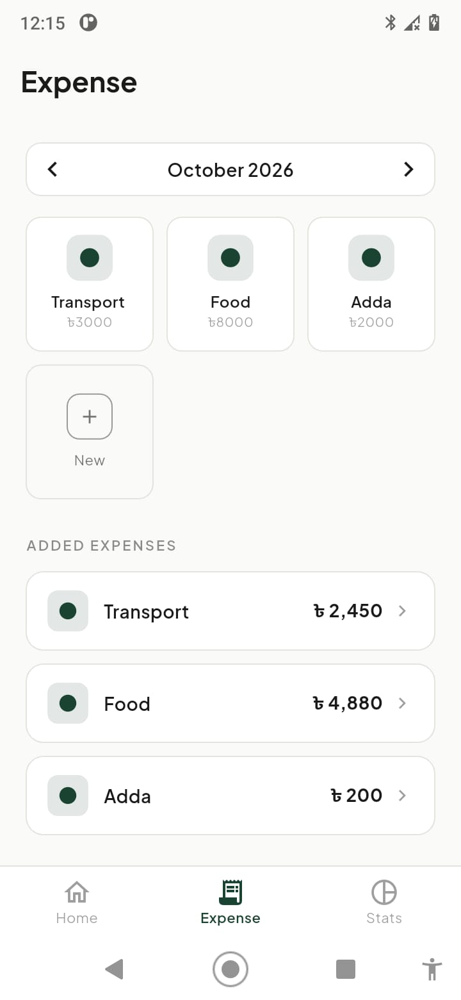
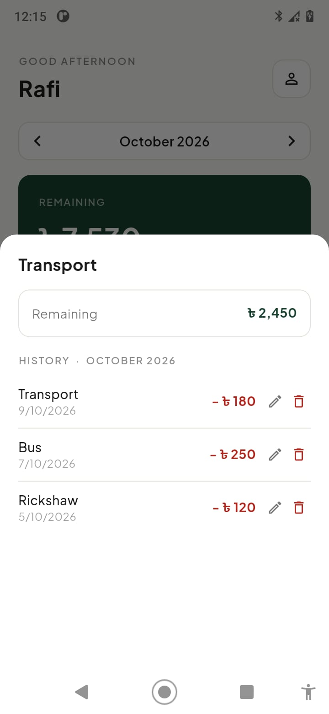
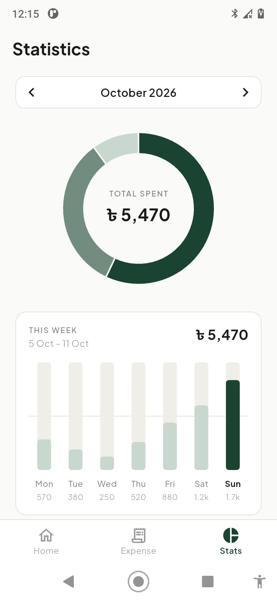
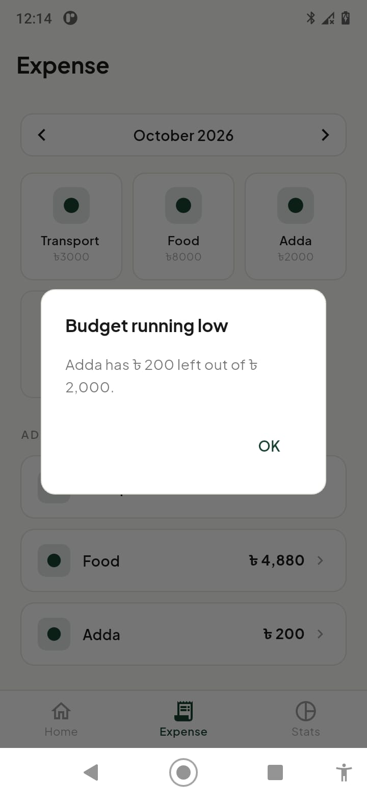
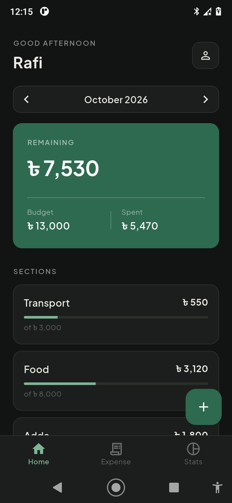

# Finance Tracker

A monthly budget tracker for Android. Instead of logging expenses after the fact and summing them up, you start by giving each spending category a budget, then record daily expenses against it and watch what is left.

Built with Flutter, Provider and SQLite. All data stays on the device.

## Screenshots

<table>
  <tr>
    <td></td>
    <td></td>
    <td></td>
  </tr>
  <tr>
    <td></td>
    <td></td>
    <td></td>
  </tr>
</table>

## Why this exists

I wanted to know how much of my monthly transport, food and hangout money was left on any given day. Most trackers record transactions and report totals. This one is built around the budget first: create a section such as "Transport" with a monthly amount, then every expense reduces what remains in that section.

## How it works

1. Create a section with a name and a monthly budget.
2. Add expenses to a section with an amount, a date and an optional note.
3. Each section shows how much of its budget is spent and how much remains.
4. When a section reaches 85% of its budget, and again when it reaches or passes 100%, a warning appears.
5. Tap a section to see its expense history for the selected month, and edit or delete any entry.

Budgets repeat every month. Spending is counted per calendar month, so a new month starts with a full budget.

## Features

- Sections with a monthly budget and a live remaining amount
- Daily expense entry with date and note, with edit and delete
- Month selector shared across Home, Expense and Statistics
- Statistics: donut chart of spending by section, a weekly bar chart for the current week, top section and a breakdown
- Budget warning that appears only when a threshold is crossed, not on every entry, with an on/off switch in Settings
- Time-based greeting using the name you set
- Light, Dark and System themes, remembered between launches

## Tech stack

| Area | Choice |
|---|---|
| Framework | Flutter, Dart |
| State management | Provider (ChangeNotifier) |
| Local storage | sqflite, with sqflite_common_ffi for desktop testing |
| Charts | fl_chart |
| Typography | Plus Jakarta Sans, bundled as an asset |

## Architecture

The code is split into three layers. A screen never talks to the database directly.

```
Screens and widgets  ->  Providers  ->  Repositories  ->  DatabaseHelper  ->  SQLite
```

```
lib/
  main.dart
  core/theme/         light and dark colour sets, theme builder
  data/
    database/         DatabaseHelper (singleton, schema, migration)
    models/           CategoryModel, TransactionModel
    repositories/     category, transaction and settings queries
  providers/          CategoryProvider, TransactionProvider, SettingsProvider
  screens/            main shell, home, expense, stats, settings
  widgets/            shared widgets: month selector, history sheet, budget warning, form helpers
```

### Data model

```
categories    id, name, type, iconCode, colorValue, monthlyBudget, isDefault
transactions  id, type, amount, categoryId (FK, ON DELETE CASCADE), date, note
settings      key, value
```

## Design decisions

- **Money is stored as an integer number of paisa.** Floating point cannot represent values like 0.1 exactly, which is not acceptable for money.
- **Remaining budget is calculated, never stored.** It is the section budget minus that month's expenses, so editing or deleting an expense can never leave a stale total behind.
- **Warnings compare before and after.** A warning appears only when an expense moves a section into a more severe state. Adding a small expense to a section that was already warned does not show the dialog again.
- **The warning uses the expense's own month.** Adding an expense dated last month checks last month's budget, not the month currently on screen.
- **Colours live in one place.** A `ThemeExtension` holds the light and dark palettes, so screens read colours from the theme and the whole app switches together.
- **Settings use the existing SQLite database.** A small key-value table avoids adding another storage plugin.
- **Schema changes use migrations.** The database is at version 2, and `onUpgrade` adds the settings table without touching existing data.

## Getting started

Requirements: Flutter SDK and an Android device or emulator.

```
git clone https://github.com/RainulRafi/finance-tracker.git
cd finance-tracker
flutter pub get
flutter run
```

To build an APK:

```
flutter build apk --release
```

The file is written to `build/app/outputs/flutter-apk/app-release.apk`.

On Windows, building any project that uses native plugins requires Developer Mode to be turned on in Windows settings.

## Known limitations

- A section cannot be edited or deleted after it is created, so its budget cannot be changed.
- The budget is the same every month. There are no per-month budgets.
- Currency is fixed to Bangladeshi taka.
- Warnings are in-app dialogs, not system notifications.
- Deleting an expense has no confirmation step.
- There are no automated tests yet.
- The `type` and `colorValue` columns remain from an earlier design and are no longer used by the interface.
- No export or backup of data.

## Roadmap

- Edit and delete sections
- Per-month budgets
- CSV export
- Unit tests for the budget and month logic
- System notifications for budget warnings

## Credits

Plus Jakarta Sans is distributed under the SIL Open Font License. The licence file is included in `assets/fonts`.
